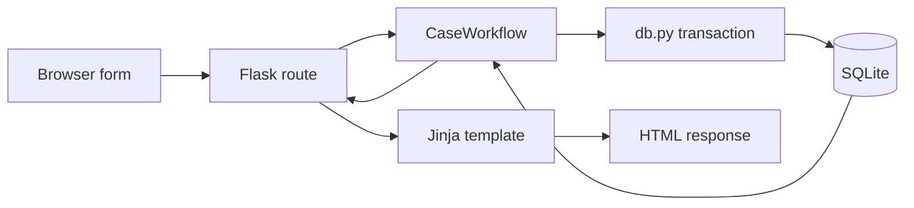

# Structure and request flow, with a Tkinter comparison

This presentation pass keeps Flask, Jinja, SQLite and the existing folders. The existing cohesive backend classes already meet the requested object-oriented structure; they were preserved. No generic repository layer, new framework or class-per-page hierarchy was introduced.

## Current folders and files

| Location | Plain-language responsibility |
|---|---|
| `app.py` | Entry point: `create_app()` configures Flask, connects routes to services, installs request/session/CSRF checks and returns responses. Flask discovers this factory with `--app app`. Routes contain no clinical SQL. |
| `backend/services.py` | `CaseWorkflow(identity)` owns case/profile retrieval, the clinician queue, ownership/assignment checks, draft edits, uploads coordinated with SQL, submission, reviews and legal transitions. It has one current identity per request, not one class per page. |
| `backend/auth.py` | `AuthService` creates patient accounts, verifies passwords, loads roles/entity links from Account on every request, starts/clears sessions and provides operator-only account provisioning. No web role selector exists. |
| `backend/images.py` | `ImageStorage` decodes/validates images, encrypts exact original bytes/metadata, enforces file/count limits, creates private storage identifiers, hashes actual stored bytes, verifies files and cleans up failed writes. It does not make clinical decisions. CaseWorkflow authorizes image access before asking it for a file path. |
| `backend/db.py` | Ordinary functions manage SQLite connections, foreign keys, busy timeout, transactions, initialization and the additive v2→v3 authentication / v4 encryption setup. No ORM/repository abstraction is needed for these SQL statements. |
| `backend/validation.py` | Ordinary small functions handle required text, real dates, integer duration, enum choices, roles and UTC timestamps. `Problem` carries a translation key and HTTP status to the shared error handler. |
| `backend/ai/adapter.py` | Typed input/output dataclasses, the Adapter protocol and UnconfiguredAdapter. Omar's eventual implementation plugs into `AI_ADAPTER` without changing the frontend. |
| `backend/ai/runner.py` | Ordinary orchestration functions preserve AI attempt snapshots/history, enforce timeout and validate output. This separation keeps inference independent from persistence/retry behavior. |
| `backend/safety.py` | Independent unconfigured safety protocol. No invented clinical rules. |
| `backend/i18n.py` | Small central English catalog and Arabic locale fallback. Includes all new account/navigation/error text. |
| `backend/demo.py` | Explicit synthetic-data seed/reset helpers for the named demo database. Kept separate to avoid mixing demonstration data into normal request behavior. |
| `templates/` | Jinja HTML for presentation: labels, forms, links, images and result display. `base.html` is the shared page/navigation; `macros.html` shares token/input/profile rendering. No SQL or case-state writes. |
| `static/app.css` | Shared restrained medical presentation, responsive layout, labeled badges, logical CSS properties and visible focus states. No build step or UI library. |
| `templates/intake.html` | Shared one-page draft intake: all sections visible, with one atomic save/submit endpoint. |
| `static/camera.js` | Optional live camera: browser permissions, capture to pending file and device-track cleanup. Native capture is ordinary HTML. |
| `static/forms.js` | Progressive form submission/error recovery, double-click protection, close confirmation and selected-image previews/removal. Native forms and links still work without JavaScript. |
| `instance/demo.sqlite3` | Historical plaintext source database; preserved for rollback, not used by the encrypted launcher. |
| `instance/uploads/` | Historical plaintext source images, preserved for rollback; active images are in instance/encrypted/uploads. Access is through the authorized backend image route. |
| `instance/session.key` | Private signing secret; retained across restarts and excluded from Git. Passwords are not stored here. |
| `instance/demo.before-auth-v3-*.sqlite3` | SQLite-consistent pre-migration backup, excluded from Git. |
| `schema.sql` / `auth_migration.sql` | Unchanged supplied base v2 schema / the one-table additive authentication extension. |
| `tests/` | Existing workflow and AI tests plus account/migration tests; test-only AI fixtures and real HTTP/restart checks using isolated synthetic records. |
| `docs/` | Architecture, authentication migration, AI integration, requirement gaps and actual test results. |

No folder consolidation is recommended now. Templates, private instance data and public static assets have different access rules; merging them would obscure those rules. The AI contract and runner have distinct jobs. Small related case operations stay together in one CaseWorkflow, and validators stay functions. Empty `__init__.py` files simply mark Python packages. The two new cohesive modules `auth.py` and `images.py` live directly in the existing backend folder; no new folder was created for classes.

## How a request moves

For a patient submitting a case:

1. The browser sends POST `/cases/7/submit` with its signed session cookie, CSRF token and consent.
2. The request hook asks AuthService to resolve the Account ID to an active database account, role and patient link. It verifies the CSRF token. Old demo identity cookies are ignored.
3. The route calls `CaseWorkflow(g.identity).submit_case(7, request.form)`.
4. CaseWorkflow opens a transaction through db.py, verifies patient ownership and legal state, checks the saved questionnaire/sites/images/consent, and writes status and UTC consent/submission timestamps. ImageStorage verifies stored hashes. A failure rolls back; a repeated submission reuses the case/time.
5. The route returns a redirect to GET `/cases/7`. The GET route calls `CaseWorkflow.case_details(7)`, which authorizes and reads the database.
6. The route passes the returned data to `templates/case.html`. Jinja escapes user text, renders translated display labels, and returns HTML. The browser displays the result.

Authentication/session resolution runs before the route. Private image responses follow the same authorization path, then send the file rather than rendering a template. Inference uses the typed AI adapter and runs outside a database transaction; clinician review does not depend on it.

## Relating this to Tkinter

| Familiar Tkinter idea | Flask equivalent |
|---|---|
| Creating the root application and binding commands | `create_app()` sets up Flask and registers routes |
| A button's `command` callback reading Entry/Combobox values | A route reads `request.form`/`request.args`, calls a service and returns a response |
| A controller/service object holding workflow behavior | CaseWorkflow, AuthService and ImageStorage each have a cohesive job |
| Your sqlite3 connection and SQL model code | db.py plus service SQL/transactions |
| Frames, Labels, Entry widgets and layout code | Jinja templates and native HTML controls |
| Populating widgets from saved data | Passing service data to `render_template()` |
| Showing a validation dialog | Rendering the shared translated error page with an appropriate status |

The main difference is lifetime. Tkinter widgets usually remain alive inside one event loop; a web request ends after its response. Do not keep the current patient or form data on a shared global service object. CaseWorkflow gets the current identity for that request; the signed session cookie contains only an account identifier, and the server reloads its role/link from SQLite. Persistent patient/case state belongs in the database and private image storage. Templates describe what the user sees; services decide what may be saved.

## Presentation enhancements (2026-10-10)

The shared base template loads one stylesheet and one deferred JavaScript file. Templates retain all form fields, role-specific navigation and presentation decisions. Translation text for JavaScript is supplied by translated data attributes; JS does not invent clinical labels or decisions. Native details/summary elements keep review history expandable with keyboard support without JS.

For enhanced forms, JavaScript sends FormData with `X-Form-Response: json`. The normal route still calls the same service. After a successful POST redirect, the shared response hook returns the destination as JSON instead of following the redirect inside fetch. The browser then navigates to the ordinary GET/template. This preserves the server's flash notices and displays success only after the server commits. Ordinary forms receive their original HTTP redirects. Validation/authorization errors remain translated HTML with their original error status; JavaScript displays their alert beside the unchanged form and restores its buttons. On a lost connection, the UI asks the user to check persisted state before retrying, because the server may have committed despite a lost response. There is no automatic retry or claimed offline support.

Previews use temporary browser object URLs. Removal affects only the pending FileList, not persisted images; URLs are released when selections change or the page is left. Decode/type/size limits remain authoritative in ImageStorage. Closing a reviewed case prompts for confirmation when JavaScript is available. No image-delete or case-delete operation was added.

In Tkinter terms, templates plus CSS correspond to widget creation/layout; forms.js is optional local widget behavior such as a thumbnail preview or disabling a button during a callback. Flask routes remain the callbacks, services hold the application rules, and SQLite holds durable state. Browser preview state is temporary like an unsaved Entry value; saving still requires the server callback and transaction.

## Combined intake request

POST `/cases/<id>/intake` sends the questionnaire, sites, existing-file selections, native/live camera field and Save/Submit choice. The thin route delegates to CaseWorkflow.save_intake. That method opens one database transaction, verifies ownership/state, and reuses draft, image and consent operations with the same connection. ImageStorage validates and writes original bytes; SQL stores their MIME/hash and private identifier. Any validation/SQL failure rolls back and removes new files. Repeated Submit against an already submitted own case returns its existing result without adding files. Ordinary individual draft/image/submit routes remain for compatibility; the UI now uses the combined endpoint. The schema is unchanged.

Patient headings/lists hide internal case numbers; the complaint and creation time identify their cases. IDs remain in routes and clinician views. Metadata preservation applies to future originals only and does not create structured geography, outbreak detection or new inference behavior.

## Encrypted persistence and preprocessing

`backend/security.py` owns Fernet key loading, field contexts and strict authenticated decoding. `backend/preprocessing.py` owns canonical gender/one-hot and NULL-preserving symptom encodings. `encryption_migration.sql` is the minimal v4 extension; `backend/migrate_encryption.py` builds a verified encrypted dataset from a plaintext source in memory and publishes a new directory. `run-local.sh` selects the active encrypted DB/uploads and an environment-managed private key file. The supplied schemas are preserved.

Routes → services → encrypted writes/database → authorized decryption → templates remains the request flow. Authorization checks nonsecret IDs/roles/status before decryption. Required values and clinical rules are validated before encryption because SQL cannot inspect ciphertext. Structured symptom flags remain NULL in old constrained columns; the companion encrypted payload contains their actual int/NULL values. Current application connections retain foreign keys/busy timeout/transactions, and SQL guards prevent accidentally writing plaintext clinical fields.

Private images follow route → case authorization → ImageStorage authenticated in-memory decryption → no-store byte response. Future adapter readers use that same helper and original hash, without changing the typed contract or adding model behavior. The request-owned service uses the one startup-validated cipher so a changed key file cannot create mixed-key writes during a running process. Patient service data excludes private notes/AI history; templates never receive those fields.

Active files: `instance/encrypted/demo.sqlite3`, `instance/encrypted/uploads/`; key: `instance/encryption.key`, selected explicitly through environment configuration. SQLite field/file encryption leaves operational relational metadata queryable. The medical-history schema gap remains; history written into supported notes is encrypted.
